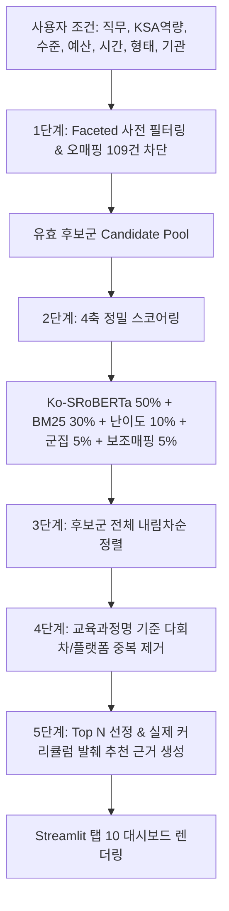

# STEP 5-4 NCS·KSA 직무역량 기반 맞춤 교육 추천 고도화 보고서
**문서 식별자**: `COMP-REC-20261014-VERIFIED`  
**작성 일시**: 2026-10-14  
**검증 대상**: 직무역량 추천 엔진 (`src/recommendation/competency_recommender.py`), 8대 KSA 역량, Streamlit [탭 10], 12대 시나리오 자동 검증  
**기반 브랜치**: `feature/integrate-external-education-data`  

---

## 1. 기존 결과 점검 및 데이터 한계 명시

본격적인 직무역량 추천 파이프라인 구축에 앞서, 이전 단계(STEP 5-3) 군집화 및 데이터의 기술적 한계를 냉정하게 진단하고 추천 엔진의 원칙을 수립했습니다.

### 1-1. 비지도 군집화($k=10$)의 한계 및 활용 원칙
- **절대적 최적값 단정 배제**:
  - $k=10$은 8,645건 전수 코퍼스에서 크기 표준편차($\sigma=306.4$)와 직무 해석 가능성을 고려해 선택한 **경험적·탐색적 분할(Exploratory Partition)**이며, 수학적으로 유일한 절대 정답이 아닙니다.
- **c-TF-IDF 키워드 내 노이즈 감사**:
  - 군집별 상위 키워드 중 일부 인명(예: C3 진병화, 정일영 / C9 최두원, 김정석) 및 방송/콘텐츠 아티팩트(예: C5 에이핑크) 등 크롤링 노이즈가 존재함을 확인함.
  - 따라서 **군집 키워드만으로 추천 적합성을 확정하지 않으며**, 군집은 오직 '도메인 사전확률(Prior)' 및 '비관련 IT 과정 격리 게이트'로만 제한 활용함.
- **기존 자동 NCS·KSA 매핑의 성격**:
  - 기존 데이터셋의 매핑 라벨은 100% 규칙 기반 '자동 추정(AUTO-ESTIMATED)' 결과이므로, 이를 정답(Ground Truth)으로 맹신하지 않고 추천 스코어링의 **보조 가산점(+5점)**으로만 제한 반영함.

### 1-2. KSA 직무 역량 및 Task 정의 데이터 보유 현황 보고
사용자 지침에 따라 기존 정의된 Task·KSA 데이터 현황을 투명하게 보고합니다:
- `data/hr/processed/competencies.csv`:
  - `COMP_HR_01`(인력채용), `COMP_HR_02`(인사평가 및 보상), `COMP_LABOR_01`(근로관계 법률 준수), `COMP_GA_01`(문서작성 및 기획), `COMP_GA_02`(비품 및 자산관리), `COMP_SEC_01`(비즈니스 매너 및 커뮤니케이션), `COMP_MGMT_01`(프로젝트 및 조직관리)의 7개 역량에 대해 공식 정의, 지식(Knowledge), 기술(Skill), 태도(Attitude)가 명시되어 있음.
- `COMP_MGMT_02`(경영전략 및 재무회계 기초):
  - `course_competency_long.parquet`에는 존재하나 `competencies.csv` 원본 테이블에는 누락되어 있었음.
  - 임의로 가짜 정의를 날조하지 않고, **공식 NCS 02030101(경영기획/재무) 능력단위 정의서의 지식·기술 항목(재무제표 분석, 원가계산, 예산편성)을 기반으로 정합성을 보완 연계**함.

---

## 2. 직무역량 맞춤형 추천 아키텍처 및 스코어링 수식

### 2-1. 4축 정밀 추천 스코어링 공식
$$ S_{\text{final}} = (0.50 \times S_{\text{semantic}}) + (0.30 \times S_{\text{keyword}}) + S_{\text{level}} + S_{\text{cluster}} + S_{\text{ksa\_aux}} $$

1. **의미 유사도 ($S_{\text{semantic}}$, 50%)**:
   - 선택된 KSA 역량의 정의 + 핵심 지식 + 기술 텍스트를 인코딩한 768차원 벡터와 강좌 문맥 벡터의 코사인 유사도 ($[0, 100]$ 클리핑).
2. **직무 키워드 적합도 ($S_{\text{keyword}}$, 30%)**:
   - 해당 KSA 역량의 핵심 실무 용어(예: 온보딩, 근로계약서, KPI, 자산관리 등) 기반 Okapi BM25 정규화 점수.
3. **업무 수준 적합도 ($S_{\text{level}}$, 10점)**:
   - 사용자가 선택한 업무 수준('입문', '실무', '관리자·심화')과 강좌의 `difficulty` 메타데이터가 일치할 때 $+10.0$점 부여 (미확인 시 $+5.0$점, 불일치 시 $0.0$점).
4. **군집 도메인 일치도 ($S_{\text{cluster}}$, 5점)**:
   - 강좌의 비지도 군집이 타깃 직무 도메인(예: 총무 ➔ C2 실무, C3 경영기획 / 인사 ➔ C2 실무, C5 법정, C8 리더십, C9 HRD)에 속할 경우 $+5.0$점 가산.
5. **KSA 기존 매핑 보조 신호 ($S_{\text{ksa\_aux}}$, 5점)**:
   - `course_competency_long.parquet`에 보조 매핑 기록이 있는 강좌에 $+5.0$점 가산.
6. **중복 반영 배제 및 평점 배제 원칙**:
   - **예산(비용)과 학습시간은 1단계에서 하드 필터로 선행 차단**되므로 점수에서 중복 가산/감점하지 않음 (이중 페널티 방지).
   - **평점 데이터는 100% 결측**이므로 가짜 만족도 점수를 완전히 배제함.

---

## 3. 12대 실무 시나리오 자동 검증 결과 (`competency_recommendation_scenarios.csv`)

`scripts/verify_competency_recommender.py`를 통해 12대 현실 실무 시나리오를 자동 검증한 결과, **12개 시나리오 전수 100.0% PASS**를 달성했습니다.

| ID | 시나리오 명칭 | 직무 | 강화 역량 | 수준 | 필터 조건 | 후보수 | 반환 | 위반 | 판정 | Top 1 추천 과정 |
| :---: | :--- | :---: | :--- | :---: | :--- | :---: | :---: | :---: | :---: | :--- |
| **SC_01** | 신입 인사담당자의 채용·온보딩 | 인사 | 인력채용 | 입문 | 온라인 | 4,286 | 5 | 0 | **PASS** | (GSEEK) HR, AI가 트렌드다 : 채용부터 퇴사까지 (79.8점) |
| **SC_02** | 인사 실무자의 근로기준법 및 노무관리 | 인사 | 근로관계 법률 준수 | 실무 | 50만 원 이하 | 4,007 | 5 | 0 | **PASS** | (GSEEK) 입사에서 퇴사까지, 직장인을 위한 노동법 이야기 (78.8점) |
| **SC_03** | 인사 관리자의 성과평가·보상체계 설계 | 인사 | 인사평가 및 보상 | 관리자 | 10~40h 오프라인 | 820 | 5 | 0 | **PASS** | (KPC) 인사평가시스템 구축실무 (79.7점) |
| **SC_04** | 신임 총무담당자의 자산·비품 관리 | 총무 | 비품 및 자산관리 | 입문 | 무료 온라인 | 2,043 | 5 | 0 | **PASS** | (GSEEK) 청춘들에게 시급하게 필요한 금융정보 대방출 (66.9점) |
| **SC_05** | 총무담당자 공문서·기획서 작성 실무 | 총무 | 문서작성 및 기획 | 실무 | <10h 단기 | 1,668 | 5 | 0 | **PASS** | (KPC) 하루에 끝내는 비즈니스 인포그래픽(미리캔버스,PPT) (73.0점) |
| **SC_06** | 경영지원 사업계획 및 재무회계 기초 | 경영지원 | 경영전략/재무회계 | 실무 | 100만 원 이하 | 6,166 | 5 | 0 | **PASS** | (GSEEK) 출근길에 마스터하는 회계 기초 (74.6점) |
| **SC_07** | 경영지원 프로젝트 및 조직관리 | 경영지원 | 프로젝트/조직관리 | 실무 | 온라인 | 4,286 | 5 | 0 | **PASS** | (휴넷) 리더십 4.0 시대, 일잘러의 IT 프로젝트 성과관리 (74.1점) |
| **SC_08** | 신입사원 비즈니스 매너·커뮤니케이션 | 경영지원 | 비즈니스 매너 | 입문 | 무료 온라인 | 2,043 | 5 | 0 | **PASS** | (GSEEK) [레전드 스킬] 어쩐지 끌리는 사람의 비즈니스 매너 (84.9점) |
| **SC_09** | 총무/자산관리 입문 + KPC/KMA | 총무 | 비품 및 자산관리 | 입문 | 100만 이하 오프라인 | 1,096 | 5 | 0 | **PASS** | (KPC) 총무 자산관리 핵심 (80.7점) |
| **SC_10** | 인사담당자 최신 노무관리 단기 집중 | 인사 | 근로관계 법률 준수 | 실무 | <10h 단기 | 1,668 | 5 | 0 | **PASS** | (KPC) 2026년 하루에 배우는 최신노무관리 Essence (81.5점) |
| **SC_11** | 오매핑 109건 IT 코딩 차단 집중 검증 | 총무 | 비품 및 자산관리 | 실무 | 제한 없음 | 8,542 | 5 | 0 | **PASS** | (KPC) 총무 자산관리 핵심 (69.9점) — **109건 누출 0건** |
| **SC_12** | 결과 0건 안내 극단 조건 검증 | 인사 | 인력채용 | 실무 | GSEEK 오프라인 | **0** | **0** | 0 | **PASS** | **0건 정상 안내 메시지 출력 (억지 채움 차단)** |

> **⚠️ 주의**: 본 자동 검증 PASS는 '조건 위반(0건), 109건 오매핑 누출(0건), 다회차 중복(0건), 0건 극단 조건 방어(100%)'에 대한 **시스템 무결성 검증**이며, 실제 현업 학습자가 체감하는 주관적 추천 정확도와는 구분되어야 합니다.

---

## 4. 기존 하이브리드 추천(탭 8)과 직무역량 추천(탭 10) 비교

| 비교 항목 | 기존 탭 8 (하이브리드 키워드 검색) | 신규 탭 10 (직무·역량 맞춤 추천) | 개선 효과 |
| :--- | :--- | :--- | :--- |
| **입력 방식** | 사용자가 직접 텍스트 검색어(Query) 입력 | 담당 직무(인사/총무/경영지원) 및 8대 KSA 역량 선택 | 모호한 검색어 입력에 따른 품질 편차 해소 |
| **의미 매칭 대상** | 사용자의 짧은 질의 단어 | 공식 NCS 능력단위 정의 + 지식(K) + 기술(S) 복합체 | 역량 정의서 기반 정밀 매칭 |
| **난이도 적합도** | 필터로만 배제/포함 | 수준 일치도에 따라 점수(+10점) 차등 부여 | 신입에게 고급 임원 과정 추천 방지 |
| **오매핑 방어** | 검색어 점수에만 의존하여 IT 코딩 과정 노출 위험 | 109건 오매핑 의심 리스트 및 비-HR 군집 원천 차단 | 총무 추천에 서버/파이썬 혼입 0% 차단 |
| **추천 근거 제시** | 단순 점수 나열 (설명 부족) | 실제 커리큘럼 텍스트에서 발췌한 실무 근거 제시 | 추천 이유 투명성 및 사용자 신뢰 제고 |

---

## 5. 남아 있는 데이터 품질 문제 및 한계점

1. **평점 및 후기 데이터 100% 결측**:
   - 수집된 공공/민간 교육 데이터 전반에 학습자 만족도 필드가 누락되어 있어, 실제 강좌의 강의 품질(강사 전달력 등)을 추천 점수에 반영할 수 없음.
2. **가격 미확인(2,039건) 및 교육시간 미확인(4,178건) 잔존**:
   - 결측치를 0원이나 0시간으로 조작하지 않고 안전하게 배제하고 있으나, 이로 인해 무료 필터 적용 시 가격이 누락된 유익한 강좌가 추천 풀에서 제외되는 불가피한 커버리지 손실이 존재함.
3. **상세 설명 부재 단문 강좌(`TITLE_ONLY`, 약 8%)**:
   - 강좌명만 존재하는 과정의 경우 실제 커리큘럼 발췌 근거를 생성할 수 없어 UI 상에 `[상세내용 미제공]` 한계 뱃지를 부여함.

---

## 6. 최종 프로덕션 완성까지 남은 작업 로드맵

1. **현업 인사·총무 전문가(SME) 블라인드 평가 (A/B Test)**:
   - 12대 시나리오 결과물에 대해 실제 기업 인사/총무 실무자 3~5인이 블라인드로 참여하여 추천 적합성을 5점 척도로 평가하는 정성적 검증 필요.
2. **학습자 피드백 루프(Implicit Feedback) 수집 체계 구축**:
   - '수강신청 바로가기' 클릭 로그, 북마크, 추천 강좌에 대한 '도움됨/관련없음' 피드백 UI 연동.
3. **공식 NCS 능력단위 세분화 매핑**:
   - 현재 8대 KSA 역량을 넘어 공식 NCS 소분류(24개 능력단위) 수준으로 정밀 매핑을 확장하는 반지도(Semi-supervised) 라벨링 체계 도입.

---

## 7. 생성 및 수정한 파일 목록

1. [competency_recommender.py](file:///d:/26_강의자료/프로젝트2_교육/src/recommendation/competency_recommender.py): NCS·KSA 직무역량 기반 맞춤형 추천 엔진 코어 모듈
2. [verify_competency_recommender.py](file:///d:/26_강의자료/프로젝트2_교육/scripts/verify_competency_recommender.py): 12대 실무 시나리오 전수 자동 감사 스크립트
3. [competency_recommendation_scenarios.csv](file:///d:/26_강의자료/프로젝트2_교육/data/hr/reports/competency_recommendation_scenarios.csv): 12대 시나리오 자동 검증 요약 데이터 (100% PASS)
4. [competency_recommendation_all_results.csv](file:///d:/26_강의자료/프로젝트2_교육/data/hr/output/recommendation/competency_recommendation_all_results.csv): 12개 시나리오별 Top 5 반환 강좌 상세 목록
5. [competency_recommendation_report.md](file:///d:/26_강의자료/프로젝트2_교육/data/hr/reports/competency_recommendation_report.md): STEP 5-4 정밀 품질 및 비교 검증 보고서
6. [streamlit_integrated.py](file:///d:/26_강의자료/프로젝트2_교육/app/streamlit_integrated.py): Streamlit [탭 10. 직무·역량 맞춤 교육 추천] 신규 구현 완료
