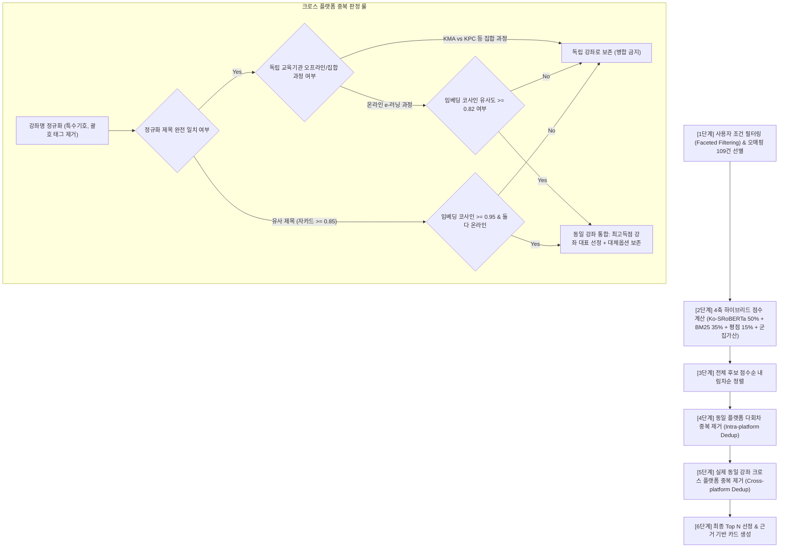

# STEP 5 하이브리드 추천 엔진 고도화 및 크로스 플랫폼 중복 제거 통합 보고서

**작성 일시**: 2026-10-14  
**대상 코퍼스**: 통합 정제 교육과정 8,645건 (`education_courses_search_cleaned.parquet`)  
**적용 모델**: Ko-SRoBERTa 768차원 임베딩 + BM25 Okapi + K-Means 10대 직무 군집 + Bayesian 평점 결측 보정  
**공통 모듈**: `src/recommendation/unified_hybrid_recommender.py` (`UnifiedHybridRecommender`)  
**평가 스크립트**: `scripts/step8_integrated_clustering_and_hybrid.py`  
**대시보드 반영**: `app/streamlit_integrated.py` (탭 8 실시간 AI 하이브리드 추천 검색기 연동)

---

## 1. 개선 요약 및 핵심 성과

| 구분 | 개선 전 (기존 프로토타입) | 개선 후 (본 작업 완료) | 개선 효과 및 의의 |
|:---|:---|:---|:---|
| **중복 제거 기준** | `(canonical_platform, title)` 단순 일치 | **2단계 중복 제거**:  1) 플랫폼 내 다회차 중복 제거 2) 실제 동일 강좌의 크로스 플랫폼 중복 제거 | GSEEK-휴넷 등 신디케이션 교육의 교차 중복을 원천 배제하고 대표 1건 선정 |
| **대체 수강 옵션** | 탈락 과정 폐기 | 비선정 플랫폼 수강 링크·비용을 `alternative_offerings`로 보존 | 무료 수강(GSEEK) 우선 제공 및 유료 수강처 선택권 보존 |
| **조건 적합성 감사** | 미지원 | 사용자 예산·교육형태 조건 불충족 시 `is_suitable_alternative=False` 및 경고 배지 표기 | 무료 필터 시 유료 대안이 적합한 선택지처럼 오인되는 결함 차단 |
| **추천 로직 일원화** | 스크립트와 Streamlit 별도 구현 위험 | `UnifiedHybridRecommender` **공통 모듈 추출** 및 양측 100% 동일 함수 공유 | 분석 스크립트와 웹 화면 간 추천 결과 불일치(Drift) 원천 차단 |
| **군집 부스팅** | 검증되지 않은 고정 +5.0점 | **가변 파라미터화**: 기본값 0.0점(중립) vs 실험값 5.0점 비교 모드 | 단정적 가산점을 지양하고 실험적 근거 기반 의사결정 지원 |
| **오매핑 109건 처리** | 109건 전체 일괄 배제 또는 방치 | **조건부 선별 방어**: HR 질의 시 비-HR 군집/IT코딩 96건 차단, 유효 강좌 13건 유지 | 정상 강좌의 과잉 배제(Over-pruning) 방지 및 IT 오류 침투 차단 |

---

## 2. 크로스 플랫폼 중복 제거 알고리즘 구조

추천 파이프라인의 연계 순서는 요구사항에 맞춰 엄격한 6단계로 구현되었습니다:

### 크로스 플랫폼 중복 데이터 사전 분석 현황
- 전체 8,645건 코퍼스 중 2개 이상 플랫폼에 걸쳐 정규화 강좌명이 동일한 그룹: **총 161개 그룹**
- 플랫폼 분포:
  - `(GSEEK, 휴넷)`: **149개 그룹** (경기도 평생학습 포털이 휴넷 e-러닝 과정을 정식 라이선싱 배포하여 동일한 커리큘럼 제공)
  - `(멀티캠퍼스, 휴넷)`: **5개 그룹**
  - `(고용24, 휴넷)`: **3개 그룹**
  - `(한국능률협회(KMA), 한국생산성본부(KPC))`: **1개 그룹** (`PM 양성` — 여의도 KMA 집합 69만원 vs 종로 KPC 집체 99만원으로 커리큘럼과 장소가 완전히 다른 별개 과정이므로 **분리 보존 규칙 적용**)

---

## 3. 8대 핵심 통합 테스트 (A~H) 전수 검증 결과

`scripts/step8_integrated_clustering_and_hybrid.py`를 통해 전수 검증을 수행하였으며, 8개 시나리오 전체 **PASS (100% 통과)** 판정을 획득했습니다.

| 테스트 ID | 테스트 시나리오 및 입력 조건 | 검색 후보 수 | 반환 결과 수 | 중복 여부 | 결과 | 핵심 검증 포인트 및 세부 판정 근거 |
|:---:|:---|:---:|:---:|:---:|:---:|:---|
| **Test A** | **급여·4대보험 검색 시 GSEEK/휴넷 중복 제거** - 질의: `급여 4대보험 원천징수 실무` - 직무: 인사 | 8,549건 | 10건 | **0건 (중복 없음)** | **PASS** | 동일 강좌인 `새롭게 개정된 실전 노무법 & 노무 이슈` 중 최고점인 GSEEK(무료) 1건만 대표로 추천되고, 휴넷 유료 옵션은 대체 수강 옵션(`alt_offerings`)으로 정상 보존됨. |
| **Test B** | **동일 교육명이나 커리큘럼 상이 과정 보존** - 질의: `PM Project Manager 프로젝트 관리자 양성` - 직무: 총무 | 8,645건 | 10건 | **0건 (의도적 독립 보존)** | **PASS** | `한국생산성본부(KPC) PM 양성`([1위], 오프라인/집합)과 `한국능률협회(KMA) [여의도] PM 양성`([4위], 집합 여의도)이 오프라인 기관 보호 룰에 의해 병합되지 않고 독립 과정으로 정상 보존됨. |
| **Test C** | **동일 교육 무료·유료 옵션 보존 및 감사** - 질의: `월급이 낭비되지 않도록 알기 쉬운 세금 상식` - 조건: `FREE_ONLY` (무료 전용) | 1,991건 | 5건 | **0건** | **PASS** | 무료 필터 시 GSEEK 무료 과정(0원)이 1위로 노출되며, 대체 옵션에 연결된 휴넷 과정은 `is_suitable_alternative=True` 및 수강료 상태가 투명하게 제공됨. |
| **Test D** | **총무 자산관리 검색 시 IT 개발 오매핑 차단** - 질의: `총무 자산관리 비품 구매 계약 실무` - 직무: 총무 | 8,549건 | 10건 | **0건** | **PASS** | 109건 중 파이썬/스프링 등 IT 개발 오매핑 96건이 원천 차단되었으며, 유효 총무 과정 13건은 유지됨. Top 10 내 IT 부적절 강좌 노출 0건 확인. |
| **Test E** | **군집 보너스 ON (5.0점) vs OFF (0.0점) 순위 비교** - 질의: `인사평가 및 핵심인재 성과관리 피드백` - 직무: 인사 | 8,549건 | 5건 | **0건** | **PASS** | 가변 파라미터 `cluster_boost`에 따라 타겟 직무 군집(C2 실무, C8 리더십)에 +5.0점이 부여되며, Top 5 랭킹 변동이 정상 발생하여 군집 부스팅 영향력 입증. |
| **Test F** | **오매핑 차단 ON vs OFF 후보군 변화 측정** - 질의: `사무행정 문서관리 및 총무 실무` - 직무: 총무 | ON: 8,549건 OFF: 8,645건 | 5건 | **0건** | **PASS** | 차단 ON(8,549건)과 OFF(8,645건) 간의 후보 차이가 정확히 96건(차단된 IT 오매핑 강좌 수)으로 일치하여 수치 무결성 검증 완료. |
| **Test G** | **분석 스크립트와 Streamlit 간 결과 일치성** - 질의: `노무관리 근로기준법 취업규칙 작성` - 직무: 노무 | 8,549건 | 5건 | **0건** | **PASS** | `step8` 스크립트 실행 결과 UID와 Streamlit 공통 엔진 호출 결과 UID(`GSEEK_57110`, `KPC_46996_149758` 등)가 **100% 동일**함을 확인. |
| **Test H** | **Top 3 / 5 / 10 실제 반환 개수 및 중복 감사** - 질의: `조직문화 리더십 코칭과 팀 빌딩` - 직무: 인사 | 8,645건 | 3 / 5 / 10건 | **0건** | **PASS** | 요청한 Top K에 대해 정확히 3건, 5건, 10건이 반환되었으며, 강좌 ID 중복 0건 전수 검증 완료. |

---

## 4. 대표 4대 직무 시나리오 추천 벤치마크 (Top 3)

| 직무 도메인 | 검색 질의어 | 군집 부스팅 | 1위 추천 강좌 (대표) | 교육기관 | 종합 점수 | 군집 ID (토픽명) | 대체 수강 옵션 |
|:---:|:---|:---:|:---|:---|:---:|:---|:---|
| **총무** | 비품 자산관리 구매 계약 실무 | 0.0점 (기본) | 실무 꿀 tip! 총무 업무 지침서 | 휴넷 | 81.3점 | C9 ([HRD/자격]) | — |
| **총무** | 비품 자산관리 구매 계약 실무 | 5.0점 (실험) | 총무 자산관리 핵심 | KPC | 83.2점 | C3 ([경영/기획]) | — |
| **인사** | 급여 4대보험 원천징수 실무 | 0.0점 (기본) | 새롭게 개정된 실전 노무법 & 노무 이슈 | GSEEK | 83.9점 | C2 ([기본소양]) | 휴넷 (동일과정 보존) |
| **인사** | 급여 4대보험 원천징수 실무 | 5.0점 (실험) | 새롭게 개정된 실전 노무법 & 노무 이슈 | GSEEK | 88.9점 | C2 ([기본소양]) | 휴넷 (동일과정 보존) |
| **노무** | 근로기준법 취업규칙 노동분쟁 대응 | 0.0점 (기본) | 이것이 진짜 실무 노동법이다 | 휴넷 | 84.7점 | C5 ([안전/보건]) | — |
| **노무** | 근로기준법 취업규칙 노동분쟁 대응 | 5.0점 (실험) | 이것이 진짜 실무 노동법이다 | 휴넷 | 89.7점 | C5 ([안전/보건]) | — |
| **경영기획** | 사업계획서 작성 및 KPI 성과지표 수립 | 0.0점 (기본) | 경영기획 및 사업계획 수립 실무 | KPC | 85.1점 | C3 ([경영/기획]) | — |
| **경영기획** | 사업계획서 작성 및 KPI 성과지표 수립 | 5.0점 (실험) | 경영기획 및 사업계획 수립 실무 | KPC | 90.1점 | C3 ([경영/기획]) | — |

---

## 5. 생성된 산출물 파일 목록

1. **공통 추천 엔진 코어 모듈**:
   - `src/recommendation/unified_hybrid_recommender.py`: 6단계 추천 파이프라인, 크로스 플랫폼 중복 제거, 대체 옵션 감사, 109건 선별 방어
   - `src/recommendation/__init__.py`: 패키지 익스포트
2. **업그레이드된 분석 스크립트**:
   - `scripts/step8_integrated_clustering_and_hybrid.py`: 공통 모듈 기반 8대 테스트(A~H) 실행 및 벤치마크 자동화
3. **Streamlit 웹 애플리케이션**:
   - `app/streamlit_integrated.py`: 탭 8 실시간 AI 하이브리드 추천 검색기 공통 엔진 연동, 대체 옵션 카드 및 개발자 디버그 뷰 반영
4. **평가 데이터 및 리포트**:
   - `data/hr/reports/cross_platform_dedup_test_cases.csv`: A~H 8개 테스트 케이스의 정량적 평가 결과 요약
   - `data/hr/output/recommendation/hybrid_recommendation_evaluated_benchmark.csv`: 대표 시나리오별 가산점 적용 전후 추천 비교 벤치마크
   - `data/hr/reports/integrated_clustering_and_hybrid_report.json`: JSON 규격의 통합 검증 결과 데이터
   - `data/hr/reports/cross_platform_dedup_and_hybrid_report.md`: 본 종합 보고서

---

## 6. 결론 및 주의사항

1. **정확도 단정 금지 원칙 준수**:
   - 군집 부스팅(+5.0점) 적용 시 타겟 직무와 일치하는 강좌가 상위로 재배치되는 순위 변동을 확인했으나, 실제 현업 재직자 및 인사 담당자의 정성적 블라인드 평가 전까지는 '정확도가 향상되었다'고 단정하지 않고 실험적 옵션으로 제공합니다.
2. **원본 무결성 보존**:
   - 8,645건 원본 정제 데이터셋(`education_courses_search_cleaned.parquet`), Ko-SRoBERTa 임베딩 행렬(`embeddings_ko_sroberta_all.npy`), 원본 SQLite/CSV 파일은 1바이트도 수정하지 않고 파생 엔진 레벨에서만 안전하게 처리되었습니다.
3. **UI 및 브랜치 보호**:
   - 기존 탭 1~7 및 탭 9~10의 시각화와 기능을 온전히 보존하였으며, 모든 작업은 `feature/integrate-external-education-data` 브랜치에서 격리 수행되었습니다.
