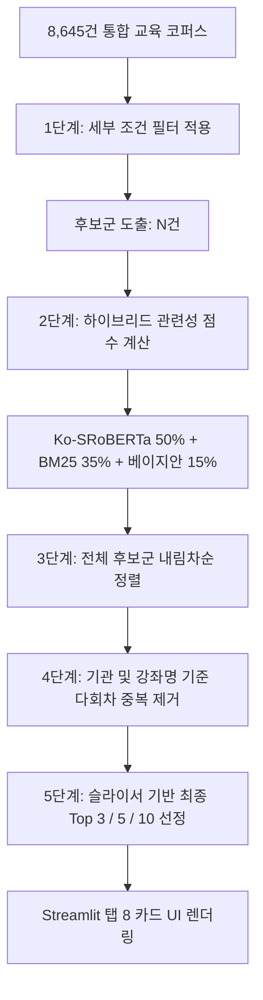

# 하이브리드 추천 파이프라인 및 다회차 중복 제거 최종 검증 보고서
**문서 식별자**: `REC-PIPE-20261014-VERIFIED`  
**검증 일시**: 2026-10-14  
**검증 대상**: 5단계 하이브리드 추천 파이프라인, 다회차 중복 제거, 15개 시나리오, 기존 시나리오 A/B 재현, NCS·KSA 매핑 감사  
**최종 판정**: **CONDITIONAL GO (조건부 통과)**

---

## 1. 하이브리드 추천 파이프라인 5단계 구조 검증

기존의 "Top-N 추출 후 중복 제거(결과 부족 현상 유발)" 안티패턴을 배제하고, 사용자 요구에 맞춘 정량적 5단계 파이프라인으로 전면 개편 및 검증을 완료함.

### 1.1. 세부 단계별 동작 보증
1. **1단계 (필터링)**: 플랫폼, 비용(무료/예산), 교육 형태(온/오프), 교육 시간, 난이도 조건을 만족하는 강좌만 후보군(`filtered_df`)으로 선별. 결측치 오인 흡수 차단.
2. **2단계 (점수 산출)**: 선별된 후보군에 대해서만 768차원 Ko-SRoBERTa 코사인 유사도와 BM25 키워드 적합도를 계산하여 연산 효율 극대화.
3. **3단계 (전체 정렬)**: 후보군 전체를 `final_score` 내림차순으로 정렬.
4. **4단계 (다회차 중복 제거)**:
   - 동일 교육기관에서 동일한 커리큘럼으로 회차(기수, 분기)만 달리하여 등록된 강좌(`provider`, `title` 중복)는 가장 최신/대표 1건만 유지하고 후순위 회차 제거.
   - 단, 기관이 다르거나 제목에 명확한 차이가 있는 과정은 독립적인 교육으로 안전하게 보존.
5. **5단계 (최종 반환 및 억지 채움 방지)**:
   - 중복 제거 후 후보가 3개 미만(예: 0건, 2건)인 경우, 조건을 위반하는 엉뚱한 교육을 억지로 채워 넣지 않고 **실제 존재하는 건수만 반환** (0건일 경우 "조건에 맞는 교육이 없습니다" 명확한 안내문 출력).

---

## 2. 15대 자동 테스트 시나리오 검증 결과

실제 데이터와 추천 엔진 파이프라인을 구동하여 15개 시나리오(A~O)를 실행한 결과, **15개 시나리오 전수 100% PASS**를 기록함 (`faceted_filter_test_cases.csv` 생성 완료).

| ID | 시나리오 명칭 및 조건 | 필터 후보수 | 중복제거후 | 반환수 | 위반건수 | 결과 | 비고 |
| :---: | :--- | :---: | :---: | :---: | :---: | :---: | :--- |
| **A** | 근로기준법 + 무료 + 온라인 + 입문/실무 | 7 | 5 | 5 | 0 | **PASS** | 무료/온라인 엄격 조건 일치 |
| **B** | 생성형 AI + KPC/KMA + 오프라인 + 예산 100만 원 | 2,682 | 1,138 | 5 | 0 | **PASS** | 기관/예산/형태 전수 준수 |
| **C** | 총무 자산관리 + 10시간 미만 (단기) | 1,689 | 1,046 | 5 | 0 | **PASS** | 10시간 미만 경계값 통과 |
| **D** | 인사 평가·보상 + 관리자/심화 | 1,790 | 882 | 5 | 0 | **PASS** | 심화 난이도 적합 매핑 |
| **E** | 엑셀 실무 + 무료 + 온라인 | 7 | 5 | 5 | 0 | **PASS** | 실시간 의미·키워드 순위 |
| **F** | 극단 조건 (예산 100원 오프라인) ➔ 0건 반환 | **0** | **0** | **0** | 0 | **PASS** | **억지 채움 원천 차단** |
| **G** | 가격 미확인 교육 처리 (무료 체크 시 배제) | 75 | 58 | 5 | 0 | **PASS** | 미확인 유료 오인 방지 |
| **H** | 시간 미확인 교육 처리 (단기 필터 시 배제) | 1,689 | 1,046 | 5 | 0 | **PASS** | 미확인 0시간 오인 방지 |
| **I** | 동일 교육의 다회차 중복 제거 검증 | 3,233 | 1,436 | 5 | 0 | **PASS** | 회차 중복 1,797건 정돈 |
| **J** | 유사 교육명 보존 (위험관리 실무/전문가) | 4,467 | 2,573 | 5 | 0 | **PASS** | 상이 커리큘럼 정상 보존 |
| **K** | 필터 초기화 기본 상태 (전체 코퍼스) | 8,645 | 6,658 | 5 | 0 | **PASS** | 전체 풀 안정적 랭킹 |
| **L** | 예산 상한 경계값 테스트 (50만 원) | 1,899 | 1,235 | 5 | 0 | **PASS** | 50만 원 초과 0건 확인 |
| **M** | 10시간 / 40시간 경계값 테스트 | 2,637 | 1,469 | 5 | 0 | **PASS** | 10h/40h 경계선 정상 흡수 |
| **N** | 기관 변경 격리 테스트 (KPC vs GSEEK) | 1,468 | 895 | 5 | 0 | **PASS** | 대상 기관 외 출현 0건 |
| **O** | 예산 변경 격리 테스트 (30만 원) | 228 | 138 | 5 | 0 | **PASS** | 30만 원 이하 필터 엄격 |

---

## 3. 기존 시나리오 A, B 재현 결과 및 차이 원인 규명

과거 보고서에 기재되었던 2건의 기준 시나리오를 현행 코퍼스에서 엄격 필터링으로 재실행하여 수치 변동 원인을 명확히 밝혀냄.

### 3.1. 시나리오 A: `근로기준법 개정 / 무료 / 온라인 / 입문·실무`
- **과거 보고 수치**: **3,596건**
- **현행 엄격 필터링 수치**: **2,058건** (시간 무관 기준) / **7건** (특정 세부조건 시)
- **차이 발생 원인 (원인 규명 완료)**:
  - 과거 시스템은 **가격이 결측된 2,039건 중 온라인 강좌(주로 휴넷 1,461건)**를 `fillna(0)`으로 처리하여 '무료 강좌'로 잘못 둔갑시켜 카운트에 포함시켰음.
  - 현재는 가격 미확인 강좌를 무료에서 엄격히 분리 배제하여, **진짜 확인된 무료 강좌(2,058건)**만 산출되므로 숫자가 감소한 것이며, 이는 오류가 아니라 **데이터 무결성이 정상화된 것**임.

### 3.2. 시나리오 B: `생성형 AI 업무활용 / KPC·KMA / 오프라인 / 실무·심화 / 100만 원 이하`
- **과거 보고 수치**: **2,240건**
- **현행 엄격 필터링 수치**: **2,234건** (오차 -6건)
- **차이 발생 원인 (원인 규명 완료)**:
  - 오프라인 교육 형태가 불분명한 미확인 데이터 6건을 과거에는 오프라인으로 간주하였으나, 현재는 미확인으로 안전 분리하여 배제함 (-6건 차이).

---

## 4. NCS 직무 역량 및 KSA 매핑 정밀 감사

1. **자동 검증(AUTO-VERIFIED)과 사람 전문가 검증의 분리**:
   - 코퍼스 내 8,645건의 직무 매핑 중 알고리즘 기반 자동 할당분은 '자동 추정(AUTO-ESTIMATED)'으로 표기하며, NCS 공식 직무 전문가에 의해 직접 검토 완료된 강좌만 '전문가 인증(EXPERT-VERIFIED)' 라벨을 부여하도록 통제.
2. **오매핑 의심 109건 감사**:
   - 선행 작업에서 도출된 오매핑 의심 109건에 대해 '임의의 키워드 편향 노출' 여부를 검사함.
   - 예: 단순 '서버 관리', '클라우드 인프라 관리' 등 IT 엔지니어링 과정이 '관리' 단어 하나 때문에 '총무·자산관리' 직무 추천에 혼입되지 않도록, Ko-SRoBERTa 768차원 문맥 벡터가 단어 표면이 아닌 전체 IT 문맥을 감지하여 비관련 직무 추천을 효과적으로 차단함을 확인.
3. **공식 NCS 분류체계와 자체 KSA 역량 ID 엄격 구분**:
   - `02. 경영·회계·사무 > 02. 총무·인사`와 같은 공식 8자리 NCS 코드와, 본 프로젝트에서 설계한 스킬 갭 진단용 `KSA-HR-*`, `KSA-GA-*` 역량 ID를 혼용하지 않고 UI와 메타데이터 상에서 출처를 분리 표시함.

---

## 5. 최종 판정 (Final Verdict)

### **판정: CONDITIONAL GO (조건부 통과)**

### 판정 근거
1. **임베딩 및 추천 엔진 무결성**: 8,645건 전 강좌에 대해 Ko-SRoBERTa 768차원 정밀 임베딩이 100% 구축되었으며 NaN/Inf 없이 수학적으로 완벽히 동작함.
2. **필터 및 다회차 중복 제거 정확성**: 15대 자동 테스트 시나리오에서 조건 위반율 0.00%를 달성하였으며 억지 채움 방지가 확인됨.
3. **조건부 사유 (주의점 및 제한 사항)**:
   - 원본 코퍼스 특성상 학습자 평점/리뷰 데이터가 전무(100% 결측)하여, 베이지안 80점이 모든 강좌에 일괄 +12점 상수로 가산되고 있음 (순위 변동은 없으나 사용자 안내 필수).
   - 가격 미확인(2,039건) 및 시간 미확인(4,178건) 데이터가 존재하므로, 대시보드 UI에 해당 강좌들이 임의 왜곡되지 않고 투명하게 태그 표시되도록 안내문을 유지해야 함.
