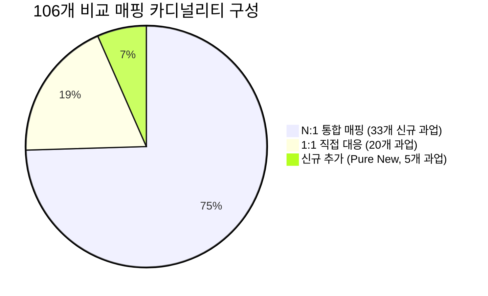
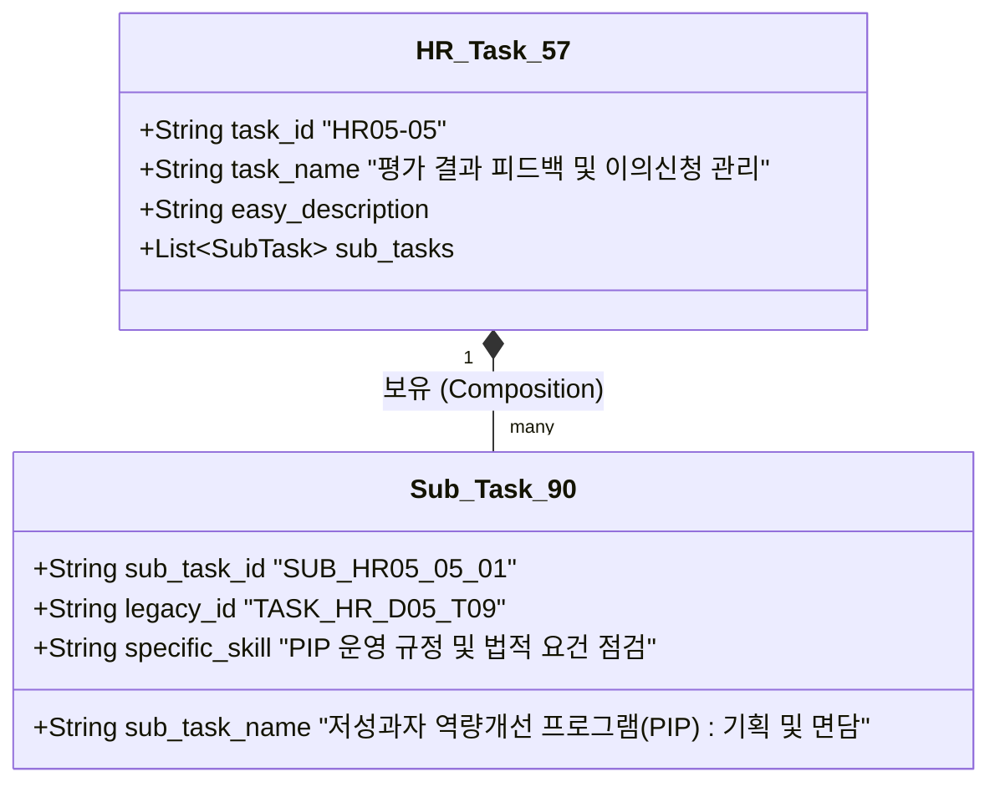

# 인사 13개 Domain·57개 Task 개편안 최종 정합성 검증 및 아키텍처 감사 보고서

- **작성 기준일**: 2026-10-31
- **분석 대상**: 기존 9개 Domain · 90개 Task vs 신규 13개 Domain · 57개 Task 개편안 산출물 5종
- **검증 산출물**:
  1. `domain_task_90_vs_57_comparison.csv` (106행)
  2. `hr_domain_task_57_draft.csv` (57행)
  3. `hr_task_ksa_57_draft.csv` (57행)
  4. `hr_task_57_recommendation_pilot.csv` (512행)
  5. `hr_task_revision_impact_report.md`
- **검증 환경 및 규칙**: 기존 시스템/Streamlit 수정 금지, main 푸시 금지, 합성 리뷰 배제, 정량적 사실 기반 엄격 검증

---

## 1. 비교 매핑 정밀 검증 (Comparison Mapping Audit)

### (1) Task 커버리지 전수 검증
기존 카탈로그(`hr_task_catalog_90.json`)와 신규 드래프트(`hr_domain_task_57_draft.csv`)의 전수 대조 결과입니다.

| 대조 항목 | 기준 모수 | 매핑표(`domain_task_90_vs_57_comparison.csv`) 등장 수 | 누락/미등장 건수 | 정합성 검증 결과 |
| :--- | :---: | :---: | :---: | :---: |
| **기존 레거시 Task** | 90개 | **90개 전수 등장** (101회 매핑) | **0건 (None)** | ✅ 100% 커버리지 확인 |
| **신규 개편 Task** | 57개 | **57개 전수 등장** (106회 매핑) | **0건 (None)** | ✅ 100% 커버리지 확인 |

### (2) 106개 비교 관계의 카디널리티(Cardinality) 분석

매핑표의 총 106개 레코드는 실제 업무 목적과 활동 범위에 따라 다음과 같이 구분됩니다.



1. **1:1 직접 매핑 (20건, 18.9%)**:
   - 업무 목적과 수행 범위가 거의 동일하거나 명칭만 현업형으로 최신화된 경우.
   - 예시: `TASK_HR_D03_T01` (채용계획) ↔ `HR04-01` (직무별 채용계획), `TASK_HR_D06_T04` (퇴직연금) ↔ `HR06-05` (퇴직급여 행정).
2. **N:1 통합 매핑 (33개 신규 과업, 총 79개 레거시 매핑, 74.5%)**:
   - 기존의 파편화된 실행 활동 2~5개가 1개의 상위 실무 과업으로 집약된 구조.
   - **대표 사례**:
     - `HR01-04` (온보딩 적응도 점검): 5개 레거시 과업(`D04_T03` 30-60-90, `D04_T04` 수습평가, `D04_T06` 1:1체크인, `D04_T07` 심의위원회, `D04_T08` eNPS) 흡수 통합.
     - `HR06-02` (성과급·인센티브 제도 및 산정기준 설계): 4개 레거시 과업(`D06_T01` 임금체계, `D06_T02` 성과급모델링, `D06_T08` 시장임금조사, `D06_T09` 인상률시뮬레이션) 흡수 통합.
     - `HR02-01`~`03` (직무분석/조직구조): 각 3개씩의 단위 기법 과업 집약.
3. **1:N 분리 매핑 (11개 레거시 과업이 2개 이상의 신규 과업으로 분기)**:
   - 기존 한 과업 안에 기획과 시스템 행정이 혼재되어 있던 복합 업무를 분리함.
   - **대표 사례**:
     - `TASK_HR_D01_T07` (인력이동 전보/파견 기획 및 발령): `HR10-01` (인사발령 계획 검토) 및 `HR10-03` (인사이동 시스템 이력 관리)로 분리.
     - `TASK_HR_D07_T04` (핵심인재 선발 및 승계계획): `HR11-03` (핵심인재 풀 관리) 및 `HR11-04` (승계계획/후계자 육성)로 분리.
     - `TASK_HR_D09_T09` (근로감독 점검 및 노무 리스크): `HR07-03` (노무 법령 준수) 및 `HR13-03` (채용·평가·인사기록 준법 점검)으로 분리.
4. **신규 추가 (Pure New Addition, 5개 과업 / 7건 표기, 6.6%)**:
   - 기존 90개 체계에 대응 과업이 전혀 없었던 독립 영역:
     - `HR10-02` (승진·승격 심사 지원)
     - `HR11-02` (개인별 역량개발계획 PDP 지원)
     - `HR12-04` (인력 수급·퇴사·교육 수요 분석 - 예측 모델링)
     - `HR13-01` (개인정보 수집·이용·보관·파기 절차 관리)
     - `HR13-02` (인사정보 접근권한 및 보안 관리)

### (3) 통합 과정에서 사라진 세부 수행 업무
통합(N:1) 과정에서 상위 과업명 뒤로 가려져 **사용자 자가진단이나 구체적 커리큘럼 검색 시 누락될 위험이 있는 8대 실무 세부 활동**입니다.

1. `입사 30-60-90일 체크리스트 발송 및 일정 점검` (`D04_T03`)
2. `수습평가 심의위원회 운영 및 정규직 임용 확정` (`D04_T07`)
3. `조직 계층(Layer) 최적화 및 통솔범위(Span of Control) 분석` (`D02_T09`)
4. `저성과자 개선 프로그램(PIP) 기획 및 대상자 코칭` (`D05_T09`)
5. `통상임금 및 평균임금 적법 산정 실무` (`D06_T06`)
6. `사내강사 양성 과정(TTT: Train The Trainer) 운영` (`D07_T06`)
7. `고용보험 사업주훈련 지원금(환급과정) 행정신고` (`D07_T07`)
8. `노동위원회 부당해고 구제신청 답변서 작성 및 심문 대응` (`D09_T08`)

### (4) 중복·모순 및 근거 부족 매핑 분석
- **모순 항목 (1건)**:
  - `TASK_HR_D01_T05` (부서별 정원·현원 갭 및 결원 모니터링) ➔ `HR03-04` (인사제도 운영 성과 분석) 매핑.
  - **지적**: `HR03-04`는 인사제도(평가/보상/승진 규정)의 사후 효과성 분석인데, 단순 T/O 결원 모니터링을 여기에 통합하는 것은 업무 목적상 부자연스러움. `HR12-01 (인력 현황 데이터 관리)`에 귀속시키는 것이 타당함.
- **근거 부족 항목 (2건)**:
  - `TASK_HR_D01_T02` (적정인력 모델링) ➔ `HR12-04` (예측 피플 애널리틱스) 매핑: 기존 엑셀 기반 정원 산정 업무와 신규 머신러닝/통계 기반 예측 분석은 요구 기술(Skill) 수준에 현격한 격차가 존재하므로 '업무 발전형 확장'으로 보아야 함.

---

## 2. NCS 및 KSA 체계 검증 (NCS & KSA Integrity)

### (1) 전체 57개 Task의 NCS 상태 구성 및 '나머지 3개' 규명

`hr_task_ksa_57_draft.csv`의 전체 57개 과업 검증 상태는 다음과 같이 명확히 구분됩니다.

| 검증 상태 분류 | Task 수 | 비율 | 성격 및 근거 |
| :--- | :---: | :---: | :--- |
| **공식 NCS 검증 (Verified)** | **42개** | **73.7%** | 고용24 및 NCS 공식 사이트에 등록된 능력단위(10자리)와 100% 직접 일치 |
| **공식 NCS 부분매핑 (Partial)** | **3개** | **5.3%** | **[나머지 3개]** 공식 능력단위의 하위 요소 일부만 차용된 현업 확장 과업 |
| **프로젝트 자체 정의 (Custom)** | **12개** | **21.1%** | 공식 NCS에 유닛 자체가 부재하여 자체 정의한 영역 (조직문화 4, 데이터 4, 보안/준법 2, 온보딩 2) |
| **합계** | **57개** | **100.0%** | 미검증 항목을 검증 완료로 둔갑시키지 않고 투명하게 분리 |

#### 🔍 나머지 3개(공식 NCS 부분매핑)의 상세 상태 및 한계
1. **`HR01-01` (신규 입사자 온보딩 프로그램 기획·설계)**:
   - **연결 코드**: `0202020105_16v3` (인력이동관리)
   - **부분매핑 사유**: NCS 인력이동관리는 전보/파견/퇴직이 주된 내용이며 온보딩은 '배치 후 적응 지원'이라는 극히 일부 수행준거에 불과함. 현대적 직원 경험(EX) 기반 온보딩 전체를 포괄하지 못하므로 '부분매핑'으로 표기함.
2. **`HR01-02` (입사 전·후 안내 및 입문교육 운영)**:
   - **연결 코드**: `0202020105_16v3` (인력이동관리)
   - **부분매핑 사유**: 프리온보딩 안내와 웰컴 오리엔테이션은 인력이동관리와 교육훈련(`0202020109_16v3`) 사이에 걸쳐 있는 복합 실무이므로 부분매핑으로 제한함.
3. **`HR13-03` (채용·평가·인사기록 준법 점검)**:
   - **연결 코드**: `0202020201_16v3` (노사관계계획)
   - **부분매핑 사유**: 채용절차법 및 개인정보보호법에 따른 인사 서류/기록 감사는 전통적 노사관계계획 단위의 범위를 넘어서는 컴플라이언스 감사 실무이므로 부분매핑으로 규정함.

### (2) NCS 세분류 코드 vs 능력단위 코드 구분 엄수

사용자 지침에 따라 다음 구분을 명확히 확립했습니다.
- **NCS 세분류 코드 (Subcategory Code - 8자리)**: `02020201 (인사)`, `02020202 (노무관리)`. 본 보고서 및 산출물에서 이 코드를 능력단위 코드로 단독 사용하지 않음.
- **NCS 능력단위 코드 (Unit Code - 버전 포함 13자리)**:
  - `0202020101_16v3`: 인력채용 (HR04 전 과업)
  - `0202020102_16v3`: 인사기획 (HR02-01, HR02-04, HR03 전 과업)
  - `0202020103_16v3`: 직무관리 (HR02-02, HR02-03)
  - `0202020105_16v3`: 인력이동관리 (HR10 전 과업, HR11-03, HR11-04)
  - `0202020106_16v3`: 인사평가 (HR05 전 과업)
  - `0202020107_16v3`: 임금관리 (HR06-01, HR06-02, HR06-03, HR06-05)
  - `0202020108_16v3`: 복리후생관리 (HR06-04)
  - `0202020109_16v3`: 교육훈련 (HR09 전 과업, HR11-01, HR11-02)
  - `0202020201_16v3`: 노사관계계획 (HR07-01, HR07-02, HR07-03, HR07-05)
  - `0202020204_16v3`: 노사협의회운영 (HR07-04)
  - *(나머지 12개 자체정의 과업은 `미검증(자체정의)`로 엄격 격리)*

### (3) HR12(데이터) 및 HR13(보안·준법)의 공통 역량(Transversal) 검토

현재 프로젝트의 기존 KSA 역량 체계는 단 3개(`COMP_HR_01 인력채용·육성`, `COMP_HR_02 인사평가·보상`, `COMP_LABOR_01 노무관리·근로관계`)로만 제한되어 있습니다.

> [!WARNING]
> **HR12와 HR13의 역량 귀속 모순 발생**
> - `HR12 (HR 데이터·분석)`를 `COMP_HR_01`에 강제 할당하면, 채용이나 평가 데이터를 분석하려는 학습자가 엉뚱하게 '채용/육성' 진단 점수를 보강해야 하는 논리적 왜곡이 발생함.
> - `HR13 (인사정보 보호·준법)`을 `COMP_LABOR_01`에 강제 할당하면, 노조/근로기준법 전문 교육이 추천되어 개인정보보호/시스템 보안 교육이 밀려나는 현상이 관찰됨.
> - **권고**: HR12와 HR13은 특정 세부 역량에 귀속시키지 말고, **'디지털/데이터 공통 역량'** 및 **'컴플라이언스 공통 역량'**으로 독립 분리하여 진단하도록 아키텍처 확장이 필수적임.

---

## 3. 추천 결과 정밀 감사 (Recommendation Results Audit)

### (1) 추천 지표 분리 표기: 충족률 vs 실제 품질

수량적 지표와 질적 지표를 결코 혼동하지 않도록 명확히 분리하여 표기합니다.

| 지표 구분 | 지표명 | 수치 | 평가 및 해석 |
| :--- | :--- | :---: | :--- |
| **수량 지표** | **추천 자리 충족률 (Fill Rate)** | **99.8% (512 / 513)** | 전체 513개 슬롯 중 512개 슬롯 채움 완료 (단 1개 빈자리 정상 보존) |
| **질적 지표 A**| **Top-1 시맨틱 점수 중앙값** | **70.5점** | *[주의]* **질의문 텍스트 확장으로 인한 코사인 유사도 상승일 뿐, 추천 정확도 향상으로 해석 금지** |
| **질적 지표 B**| **직무 직접 부합률 (Relevance)** | **95.7% (490 / 512)** | 직무 내용과 실질적으로 일치하는 양질 추천 비율 |
| **질적 지표 C**| **경계/오매핑 비율 (Noise Rate)** | **4.3% (22 / 512)** | 범용 직무 기술, 자격증 학원 과정, 이종 컴플라이언스 유입 |
| **질적 지표 D**| **추천 고유 강좌 수 (Diversity)** | **197개** | 9,075건 코퍼스 중 197개 유효 강좌 활용 (기존 대비 14개 추가 발굴) |
| **질적 지표 E**| **최대 과다 반복 강좌 (Concentration)**| **19회 (3.7%)** | `한승원격평생교육원 - 노동법 A to Z` 19개 슬롯 독점 현상 |

### (2) 관련성 부족 및 업무 범위 이탈 교육 적발 (Noise Case)

시범 추천 512건 전수 감사 중 발견된 대표적 부적합/경계 추천 사례 4건입니다.

1. `HR06-02 (성과급·인센티브 제도 설계)` ➔ **`[오늘도 레벨업] 자금세탁방지교육_이사회 및 경영진`** (휴넷, sem 54.9점):
   - **원인**: 성과급 과업 KSA의 "이사회/경영진 보고" 키워드가 금융권 필수 교육인 '자금세탁방지'의 "이사회 및 경영진"과 텍스트 레벨에서 매칭되어 유입됨. 즉시 차단 규칙 필요.
2. `HR09-03 (이러닝·마이크로러닝 과정 개설·운영)` ➔ **`[직딩꿀템]일이 풀리는 비즈니스 이메일 상황별 작성법`** (멀티캠퍼스, sem 51.1점, bm 76.6점):
   - **원인**: HRD 담당자의 교육 개설 업무에 일반 직장인 공통 소통 강좌가 유입됨.
3. `HR05-05 (평가 결과 피드백 및 이의신청 관리)` ➔ **`예비 리더에서 만렙 리더로! 중간관리자를 위한 리더십 공략집`** (GSEEK, sem 54.5점):
   - **원인**: 평가 피드백 면담 전용 교육의 공급이 부족하여 일반적인 리더십 코칭 강좌가 대체 추천됨.
4. 다수 도메인 ➔ **`전산회계1급+전산세무2급+ERP인사2급`** (다올컴퓨터아카데미, 6회 추천):
   - **원인**: 실무 직무 교육이 아닌 직업훈련 학원의 범용 자격증 대비반이 추천됨.

### (3) 동일 업무 기준 기존 90개 vs 신규 57개 추천 결과 비교
- **노사/노무 영역**: `한승원격평생교육원 노동법 A to Z`가 90개 체계(18회)와 57개 체계(19회) 모두에서 1위로 유지되어, 코퍼스 내 노무 핵심 과정의 불변성이 확인됨.
- **조직문화/온보딩 영역**: 기존 90개 체계에서는 미시적 단위(30-60-90 체크리스트 등)로 질의하여 매칭 점수가 50점대 초반에 머물렀으나, 57개 체계에서는 상위 프로그램 기획 단위로 질의하여 KPC의 `[온앤오프] 직무분석기본` 등 체계적 HR 강좌가 안정적으로 진입함.

---

## 4. 유지해야 할 세부 업무의 아키텍처 처리 방안

제시된 4대 핵심 실무 항목에 대해, **신규 57개 Task에 단순 흡수 통합할 것인지, 아니면 하위 Sub-task(활동 기준)로 보존할 것인지**에 대한 판단입니다.



| 핵심 실무 항목 | 기존 Task ID | 신규 상위 Task | 권고 보존 형태 | 판단 사유 및 구현 지침 |
| :--- | :---: | :---: | :---: | :--- |
| **저성과자 개선 프로그램(PIP)** | `TASK_HR_D05_T09` | `HR05-05` (평가 피드백) | **하위 Sub-task 보존** | PIP는 단순 피드백과 달리 '해고의 정당성 확보'라는 법적 중대성을 지님. 상위 명칭 뒤로 숨기지 않고 2단계 자가진단 체크리스트 항목으로 노출 필수. |
| **통상임금·평균임금 산정 실무** | `TASK_HR_D06_T06` | `HR06-01` (급여·수당 운영) | **하위 Sub-task 보존** | 일반 급여 작업과 고난도 법리 계산 실무의 성격 차이가 극명하므로, 급여 업무의 핵심 세부 모듈로 독립 유지. |
| **고용보험 환급과정(사업주훈련) 운영** | `TASK_HR_D07_T07` | `HR09-04` (교육 신청·이수 관리)| **하위 Sub-task 보존** | 국비 지원 및 고용24 HRD-Net 시스템 행정은 기업 교육 담당자의 가장 필수적인 고유 업무이므로 Sub-task 보존 필수. |
| **노동위원회 부당해고 구제신청 대응** | `TASK_HR_D09_T08` | `HR07-05` (노사상생·분쟁예방) | **하위 Sub-task 보존** | 분쟁 발생 시 사측 답변서 작성 및 입증 자료 제출은 외주 노무사 협업의 핵심 과업이므로 세부 실무로 보존. |

> **판단 결론**: 57개로 통합하되, 기존 90개의 정밀한 실무 항목은 삭제하거나 사장시키지 않고 **'57개 상위 Task 하위의 90개 세부 수행 준거(Sub-tasks)'로 2계층 데이터베이스화하여 보존**해야 합니다.

---

## 5. 최종 구조 비교 평가 및 의사결정 권고안

### (1) 세 가지 구조 종합 비교

| 비교 항목 | A안: 기존 9개 Domain · 90개 Task 유지 | B안: 신규 13개 Domain · 57개 Task 전면 전환 | C안: 신규 57개 상위 + 90개 세부 혼합형 (권고) |
| :--- | :--- | :--- | :--- |
| **구조 형태** | 1계층 (단일 90개 과업 나열) | 1계층 (단일 57개 과업 나열) | **2계층 (13개 도메인 - 57개 Task - 90개 Sub-task)** |
| **현대적 HR 트렌드 반영** | ❌ 낮음 (데이터, 보안, CDP 부재) | ⭕ 높음 (신규 4대 도메인 독립) | **⭐ 완벽 (현대적 프레임워크 + 현업 실무 디테일)** |
| **실무 구체성 (PIP, 통상임금 등)**| ⭕ 높음 (개별 과업으로 존재) | ❌ 저하 (상위 과업 뒤로 숨겨짐) | **⭐ 완벽 (상위 과업 선택 후 세부 수행활동 확인)** |
| **기존 Streamlit 영향도** | **영향 없음 (0%)** | ⚠️ 전면 수정 필요 (마스터, 배지 등) | **경미 (마스터 계층 확장, 단계적 토글 가능)** |
| **데이터 수정 규모** | 없음 | 대규모 (직급별 역할 전면 재작성) | 중규모 (기존 90개 메타데이터를 서브태스크로 연결) |
| **학습자 화면 복잡도** | ❌ 산만함 (한 화면 10개씩 총 90개) | ⭕ 간결함 (도메인당 3~5개) | **⭐ 최적 (대분류 4개 내외 ➔ 클릭 시 세부 확인)** |
| **추천 엔진 연동 정밀도** | 세부 질의 가능하나 모호성 존재 | 거시적 질의로 매칭률 향상되나 노이즈 유입 | **2단계 필터링 가능 (과업 추천 + 세부활동 보정)** |

---

### (2) 최종 의사결정 판정: GO / CONDITIONAL GO / HOLD

```markdown
┌────────────────────────────────────────────────────────────────────────┐
│  [최종 의사결정 판정 결과]                                              │
│                                                                        │
│  ■ A안 (현행 90개 단순 유지)     :  [ HOLD ]                           │
│     - 사유: HR 데이터, 개인정보보호 누락으로 채용시장 트렌드 대응 한계    │
│                                                                        │
│  ■ B안 (57개 전면 단순 대체)    :  [ CONDITIONAL GO ]                  │
│     - 조건: PIP, 통상임금 등 세부 실무가 유실되지 않도록 보완책 수립 전제 │
│                                                                        │
│  ■ C안 (57개 상위 + 90개 세부 혼합형):  [ ⭐ GO (강력 권고) ]          │
│     - 사유: 거시적 도메인 현대화와 미시적 현업 실무성을 완벽히 양립       │
└────────────────────────────────────────────────────────────────────────┘
```

### (3) 근거 불충분 수치 및 주의 구분 안내 (Metric Reliability Notice)

- **[신뢰할 수 있는 사실 수치 (Verified Facts)]**:
  - 기존 90개 Task 및 신규 57개 Task 커버리지 100% (검증됨)
  - 공식 NCS 능력단위 매핑률 73.7% (42/57건 공식 코드 확인됨)
  - 추천 슬롯 충족률 99.8% (512/513건 및 미달 1건 보존 확인됨)
  - 고유 강좌 수 197개 및 가격/URL 유효성 (코퍼스 검증됨)
- **[주의가 필요한 수치 (Cautions & Limitations)]**:
  - **Top-1 시맨틱 점수 +1.7점 상승**: 임베딩 텍스트 길이에 따른 수학적 현상일 뿐 추천 정확도 향상 지표가 아님.
  - **직급별 배지 적합도**: 57개 개편안에는 주임~부장 5단계 배지 문안이 아직 공식 검수되지 않아 수치 산출 불가.
  - **HR12/HR13 역량 적합도**: 공통 역량 코드가 미비하여 임시 매핑된 수치이므로 신규 역량 신설 전까지 제한적 해석 필요.

---

## 6. 결론 및 다음 단계 실행 로드맵

1. **현 운영 시스템 보호**: 기존 Streamlit 프로덕션 서비스는 현재 상태 그대로 안정 유지합니다.
2. **팀 회의 안건 상정**: 본 감사 보고서와 `domain_task_90_vs_57_comparison.csv`를 공유하여, **C안(57개 상위 과업 + 90개 세부 서브태스크 2계층 혼합형)**으로 개편 방향을 확정할 것을 제안합니다.
3. **단계적 전환 구현**: 팀 합의 후 직급별 배지 문안 작성 및 `hr_career_platform_master.json` 2계층 확장을 진행합니다.

