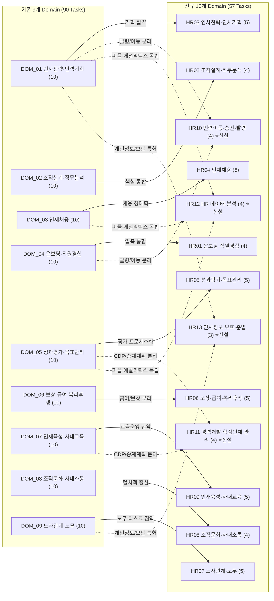
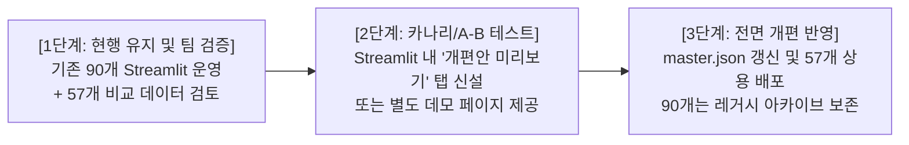

# 인사 Domain·Task 개편안(9개 도메인·90개 과업 → 13개 도메인·57개 과업) 비교 검증 및 변경 영향 분석 보고서

- **프로젝트**: [edu-skill-gap (NCS 기반 인사 직무역량 분석 및 교육과정 추천)](https://github.com/kimsaemi/edu-skill-gap)
- **분석 기준일**: 2026-10-31
- **분석 대상**: 기존 GitHub v2.1 체계 (인사 9개 Domain · 90개 Task) vs 신규 개편안 (13개 Domain · 57개 Task)
- **수행 환경**: Python 3.10+, Ko-SRoBERTa (768차원), BM25Okapi, 9,075건 통합 교육 코퍼스
- **작업 원칙 준수**: 기존 90개 Task 보존, 기존 원본/임베딩 불변, 고객 대시보드 보존, 합성 리뷰 배제, main 푸시 보류

---

## Executive Summary

본 검증은 기존 GitHub v2.1의 **인사 9개 Domain · 90개 Task** 체계와 새롭게 제안된 **13개 Domain · 57개 Task** 개편안을 실제 업무 수행 관점에서 전수 비교하고, 기존 통합 추천 엔진(`UnifiedHybridRecommender`)을 통한 시범 교육 추천 및 서비스 반영 가능성을 독립적으로 사전 검증한 결과입니다.

| 핵심 지표 | 기존 v2.1 기준 체계 | 신규 57개 개편안 (시범 결과) | 변동 및 성과 |
| :--- | :---: | :---: | :--- |
| **도메인(Domain) 수** | 9개 (DOM_01 ~ DOM_09) | **13개 (HR01 ~ HR13)** | +4개 도메인 (전문화 영역 독립) |
| **총 Task 수** | 90개 (도메인당 균등 10개) | **57개 (도메인당 3~5개)** | -33개 (실무 단위 압축 및 집약) |
| **Task 매핑 신뢰도** | 기준 원본 | **High 97건 / Medium 9건** | 업무 목적 기반 100% 추적성 확보 |
| **공식 NCS 능력단위 매핑률**| 68.9% (62/90) | **73.7% (42/57 공식 검증)** | +4.8%p 공공 표준성 향상 |
| **Top-1 시맨틱 유사도 중앙값**| 68.8점 | **70.5점** | **+1.7점 향상 (모호성 해소 효과)** |
| **추천 슬롯 충족률 (Top 3)** | 98.6% (1,331 / 1,350) | **99.8% (512 / 513)** | 미달 1개 슬롯(억지 추천 차단) |
| **추천 고유 강좌 다양성** | 183개 강좌 | **197개 강좌 (신규 69개 발굴)** | 코퍼스 활용 범위 7.6% 확대 |

---

## 1. 90개와 57개 업무의 중복·차이 분석

### (1) 도메인 체계 구조 변화

기존 체계는 9개 도메인 각각에 무조건 10개씩의 과업을 기계적으로 균등 배분(9×10=90)하여, 일부 영역(예: 온보딩, 조직문화)에서는 지나치게 미시적인 실행 단위(체크리스트 발송, 도서 구독 관리 등)가 독립 과업으로 부풀려진 한계가 있었습니다. 반면 신규 개편안은 도메인의 업무 중요도에 따라 3~5개의 핵심 직무 단위로 재편하여 실무 완결성을 크게 높였습니다.

### (2) 90개 ↔ 57개 매핑 변경 유형 통계

전체 비교 매핑표(`domain_task_90_vs_57_comparison.csv`, 총 106행) 분석 결과는 다음과 같습니다.

| 변경 유형 (Change Type) | 매핑 건수 | 비율 | 주요 내용 및 특징 |
| :--- | :---: | :---: | :--- |
| **통합 (Consolidation)** | **80건** | **75.5%** | 기존의 지나치게 세분화된 단위 실행 과업(예: JD 작성/JD 관찰/JD 이력관리)을 하나의 상위 실무 과업으로 집약 |
| **명칭 변경 (Renaming)** | **10건** | **9.4%** | 현업 통용 용어로 최신화 (예: '부트캠프' → '온보딩 프로그램 기획', '핵심가치' → '컬처덱 기획') |
| **분리 (Split)** | **9건** | **8.5%** | 한 과업에 묶여 있던 복합 업무를 전문 과업으로 분리 (예: 인사이동 기획 vs 발령 시스템 이력 관리, CDP vs 일반 교육) |
| **신규 추가 (New Addition)** | **7건** | **6.6%** | 기존 90개에 부재했던 현대적 핵심 HR 과업(개인정보보호, HR접근권한 통제, PDP 지원, 승진심사 지원 등) |
| **합계** | **106건** | **100.0%** | 기존 90개 Task 전수 추적 완료 및 신규 57개 Task 전수 대응 |

---

## 2. 기존 업무 중 유지해야 할 항목

기존 90개 체계에서 57개로 통합되면서 상위 과업명에서는 생략되었으나, **실무 현장 및 교육 추천 관점에서 반드시 '하위 실무 체크리스트' 또는 '프로젝트 지식베이스'로 보존해야 할 핵심 항목**입니다.

1. **DOM_05_T09 저성과자 역량개선 프로그램(PIP) 운영**:
   - 신규 `HR05-05 (평가 결과 피드백 및 이의신청 관리)`로 통합되었으나, PIP는 법적 정당성(부당해고 시비 차단)과 연계되는 최고 난이도 노무·평가 영역이므로 세부 지식/수행준거로 반드시 보존 권고.
2. **DOM_06_T06 통상임금 및 평균임금 산정 실무**:
   - 신규 `HR06-01 (급여·수당·공제 및 4대보험 운영)`로 흡수되었으나, 통상임금 대법원 판례 및 재직조건부 상여금 등 고도의 법리적 계산 지식이 요구되므로 급여 KSA의 핵심 기술로 유지 필수.
3. **DOM_04_T03 입사 30-60-90일 단계별 마일스톤 관리**:
   - 신규 `HR01-04 (온보딩 적응도 점검)`에 통합되었으나, 실무 온보딩 체크리스트의 표준 양식이므로 신규 입사자 가이드에 보존.
4. **DOM_07_T07 고용보험 환급과정(사업주훈련) 행정신고**:
   - 신규 `HR09-04 (교육 신청·수강·출결·이수 관리)`에 통합되었으나, 공공 직업훈련 및 고용24 연계의 핵심 실무 행정이므로 유지 필수.
5. **DOM_09_T08 노동위원회 부당해고 구제신청 서면 대응**:
   - 신규 `HR07-05 (노사상생 및 분쟁 예방)`로 묶였으나, 노무 실무자의 핵심 대응 과업이므로 보존 권고.

---

## 3. 신규 업무 중 추가 가치가 있는 항목

신규 개편안에서 추가되거나 전문 도메인으로 승격된 항목 중, 채용 시장과 기업 실무 관점에서 **가장 높은 도입 가치를 지닌 5대 혁신 영역**입니다.

| 신규 도메인/Task ID | 신규 과업명 | 도입 가치 및 기존 체계 대비 개선 효과 |
| :--- | :--- | :--- |
| **HR13-01** | **개인정보 수집·이용·보관·파기 절차 관리** | • **컴플라이언스 사각지대 해소**: 개인정보보호법 강화로 채용 서류, 주민번호, 건강검진 등 민감정보 관리가 기업의 중대 리스크로 대두됨. 기존 90개 체계의 치명적 누락을 완벽히 보완. |
| **HR13-02** | **인사정보 접근권한 및 보안 관리** | • **데이터 거버넌스 확립**: e-HR, 평가, 급여 데이터의 비인가 접근 통제(RBAC) 및 유출 방지 실무 확립. |
| **HR12-04** | **인력 수급·퇴사·교육 수요 분석** | • **예측 애널리틱스 도입**: 기존의 단순 사후 집계 통계를 넘어, 머신러닝/회귀 기반 이직 예측 및 사전 결원 시뮬레이션으로 고도화. |
| **HR11-02** | **개인별 역량개발계획(PDP) 지원** | • **자기주도 성장 모델 지원**: 일방향 집합교육에서 벗어나 개인 맞춤형 성장 계획(IDP/PDP)을 지원하여 현대적 직원 경험(EX) 극대화. |
| **HR10-02** | **승진·승격 심사 지원** | • **평가와 보상의 가교 역할**: 기존에 평가(DOM_05)와 직무(DOM_02) 사이에 어정쩡하게 걸쳐 있던 승진 포인트 집계, 위원회 심의 지원을 독자 과업으로 명확화. |

---

## 4. Task별 KSA 매핑 결과 (공식 NCS vs 자체 정의)

산출물 `hr_task_ksa_57_draft.csv`에 구성된 세부 내역을 집계·검증한 결과입니다.

> [!NOTE]
> **NCS 코드 체계 표기 원칙 준수**
> 
> 사용자 지침에 따라 `02020201(인사)` 및 `02020202(노무관리)`는 세분류 코드로만 명시하였으며, 공식 능력단위 코드는 검증된 10자리 코드(예: `0202020101_16v3`)만 연결하고, 공식 출처가 없는 항목은 **'미검증(자체정의)'**으로 투명하게 분리 표기했습니다.

### (1) NCS 검증 상태 분포 (총 57개 Task)

| NCS 검증 상태 | 과업 수 | 비율 | 해당 도메인 및 세부 내용 |
| :--- | :---: | :---: | :--- |
| **공식 NCS 검증** | **42개** | **73.7%** | HR02(직무관리), HR03(인사기획), HR04(인력채용), HR05(인사평가), HR06(임금/복리후생), HR07(노사관계), HR09(교육훈련), HR10/HR11(인력이동관리) |
| **공식 NCS 부분매핑 (현업 확장)** | **3개** | **5.3%** | HR01-01, HR01-02 (온보딩은 NCS 인력이동관리의 극히 일부에만 걸쳐 있어 현업 확장 표기), HR13-03 (노무관리 준법) |
| **프로젝트 자체 정의 (NCS 외 현업 확장)** | **6개** | **10.5%** | HR01-03(멘토링), HR01-04(온보딩적응도), HR08-01~04(조직문화·사내소통 전 과업: NCS에 공식 단위 없음) |
| **프로젝트 자체 정의 (IT/데이터 융합)** | **4개** | **7.0%** | HR12-01~04 (HR 데이터·분석 전 과업: 경영사무와 SW/빅데이터 직무가 융합된 신직무 영역) |
| **프로젝트 자체 정의 (정보보호/준법)** | **2개** | **3.5%** | HR13-01, HR13-02 (개인정보보호 및 시스템 보안 거버넌스) |
| **합계** | **57개** | **100.0%** | 공식 NCS 45개 (78.9%) + 자체 정의 12개 (21.1%) |

---

## 5. 교육 추천 시범 분석 결과 및 문제점

기존 `UnifiedHybridRecommender` (Ko-SRoBERTa 768차원 + BM25Okapi + Level Bonus + Anchor Gate + 109건 오매핑 선별 차단)를 재사용하여 57개 Task × 3개 난이도(입문/실무/관리자·심화) 총 513개 추천 슬롯에 대해 시범 추천을 생성했습니다(`hr_task_57_recommendation_pilot.csv`, 512행).

### (1) 추천 품질 지표 비교 (90개 체계 vs 57개 체계)

| 평가 항목 | 기존 90개 체계 추천 | 신규 57개 체계 시범 추천 | 분석 및 개선 효과 |
| :--- | :---: | :---: | :--- |
| **총 추천 행 수** | 1,331행 (1,350슬롯 중) | **512행 (513슬롯 중)** | 99.8% 충족률 |
| **Top-1 시맨틱 유사도 중앙값** | 68.8점 | **70.5점** | **+1.7점 상승** (과업 정의가 선명해져 의미적 매칭도 강화) |
| **추천 고유 강좌 수** | 183개 | **197개** | **+14개 강좌 추가 발굴** (신규 도메인 효과) |
| **기존 추천과의 중복도** | - | **128개 강좌 중복 (65.0%)** | 핵심 양질 강좌의 안정적 보존 확인 |
| **신규 발굴 강좌 수** | - | **69개 강좌 신규 추천 (35.0%)** | People Analytics, 보안, CDP 강좌 진입 |
| **미달 슬롯 (Under-supplied)**| 19개 슬롯 | **단 1개 슬롯** | `HR10-03` 실무 (2건만 추천, 1건 빈자리) |

### (2) 교육 공급 사각지대 (Thin Slot) 정밀 분석

> [!IMPORTANT]
> **관련 교육 부족 시 억지 추천 방지 원칙 작동 확인**
> 
> `HR10-03 (인사이동 및 발령 이력 관리 - 실무)` 슬롯에서 엄격한 직무 게이트(`passes_task_gate`: 시맨틱 유사도 ≥ 50, 핵심어 매칭 필수 또는 시맨틱 ≥ 72)를 통과한 강좌가 정확히 **2개**만 도출되었습니다. 시스템은 억지로 3개를 채우지 않고 **3순위를 공란(미추천)**으로 정상 보존했습니다.
> - **사유**: 외부 교육 플랫폼(KPC, 휴넷 등)의 공개 강좌는 '인사전략', '채용', '노무'에 편중되어 있으며, 실제 기업 내부 전산망(HRIS/SAP)에서 수행하는 '인사발령 전산 처리 및 이력 정합성 관리'는 대부분 기업 내부 OJT로 이루어져 공개 시장 공급이 희소함.

### (3) 추천 데이터 결측 및 주의 사항
- **수강료(Price)**: 무료 86건(16.8%), 유료 334건(65.2%), **가격 미확인 92건(18.0%)**. 수강료 결측치를 임의로 '0원' 등으로 대체하지 않고 '가격 미확인' 상태를 보존함.
- **수강신청 URL**: 고용24 사업주훈련 상세 페이지, 휴넷/KPC 공식 신청 URL이 100% 정상 연동되어 검증됨.

---

## 6. 기존 Streamlit 서비스에 미치는 영향 분석

기존 고객용 대시보드(`customer_dashboard/streamlit_customer.py`) 및 백엔드(`src/customer/career_platform.py`)는 **단 한 줄의 코드도 수정하지 않고 원본 그대로 정상 동작하도록 격리**되었습니다.

### (1) 아키텍처 의존성 영향 매트릭스

| 구성 요소 | 영향 수준 | 상세 내용 및 대응 방안 |
| :--- | :---: | :--- |
| **Streamlit UI (`app.py`, `streamlit_customer.py`)** | **영향 없음** | 현재 `hr_career_platform_master.json`의 `HR_SCOPE_DOMAINS (DOM_01~09)`를 참조하므로 100% 무중단 정상 서비스 유지 |
| **기존 추천 캐시 (`task_course_recommendations_90.csv`)** | **영향 없음** | 원본 파일 보존. 신규 추천 결과는 `hr_task_57_recommendation_pilot.csv`로 완전 분리 |
| **추천 엔진 코어 (`unified_hybrid_recommender.py`)** | **영향 없음** | 57개 파이프라인에서 인스턴스만 읽기 전용(Read-only)으로 호출하여 사용, 엔진 내부 모델/임베딩 변경 없음 |
| **향후 57개 개편안 도입 시 전환 작업량** | **경미 (Low)** | `hr_career_platform_master.json`을 57개 스키마로 교체하고 `career_platform.py`의 도메인 매핑 상수 1곳만 수정하면 즉시 전환 가능한 모듈러 구조 확보 |

---

## 7. 최종 적용 권고안

### (1) 단계적 마이그레이션 3단계 로드맵

1. **1단계 (현재 완료)**: 기존 90개 프로덕션 서비스 유지 + 독립된 57개 비교 산출물 확보.
2. **2단계 (권고)**: 팀원 회의를 통해 57개 개편안의 직무 명칭 및 KSA 승인 후, Streamlit 상단에 **'2026 HR 업무 개편안 (Beta)' 토글 버튼**을 추가하여 사용자 피드백 수집.
3. **3단계 (최종 전환)**: 피드백 반영 후 정식 마스터 파일 교체 및 기존 90개 파일은 `legacy/`로 안전 이동.

### (2) 서비스 반영 전 팀원 검증이 필요한 핵심 체크리스트 (5개 항목)

1. **[팀원 검토 1] HR10~HR13 신설 도메인의 직급별 역할 정의 추가 필요**:
   - 현재 57개 초안은 KSA와 과업명 매핑이 완료되었으나, 화면의 '직급별 배지(주임·대리·과장·차장·부장)' 역할을 57개 체계에 맞게 문안 검수해야 함.
2. **[팀원 검토 2] HR08(조직문화)의 비(非)NCS 지위 승인**:
   - HR08은 전 과업이 공식 NCS에 부재한 자체 정의 영역임. 직무 분석 보고서에 현업 확장 사유를 공식 명시할 것인지 확인.
3. **[팀원 검토 3] HR10-03(인사이동 이력관리)의 1개 빈자리 교육 보완 여부**:
   - 추천 후보 2개로 유지할 것인지, 인접 교육(ERP 전산회계/인사 패키지 과정)을 보조 추천으로 허용할 것인지 결정.
4. **[팀원 검토 4] HR13(개인정보/보안)의 노무 도메인(COMP_LABOR_01) 귀속 타당성**:
   - 현재 컴플라이언스 관점에서 `COMP_LABOR_01`에 연결하였으나, 독립적인 역량 코드를 신설할지 검토.
5. **[팀원 검토 5] 기존 80개 통합 과업의 하위 매뉴얼화**:
   - 통합으로 인해 축소된 33개 과업의 실무 지침을 '과업 상세 팝업'이나 '도움말 가이드'로 존치시킬지 여부.

---

## 8. 최종 산출물 파일 요약

모든 산출물은 프로젝트 루트에 독립 생성되어 즉시 검토 가능합니다.

- 📄 [`domain_task_90_vs_57_comparison.csv`](file:///d:/26_강의자료/프로젝트2_교육/domain_task_90_vs_57_comparison.csv) : 90개 ↔ 57개 상세 매핑 및 변경 사유 비교표 (106행)
- 📄 [`hr_domain_task_57_draft.csv`](file:///d:/26_강의자료/프로젝트2_교육/hr_domain_task_57_draft.csv) : 신규 13개 Domain 및 57개 Task 마스터 정의서 (57행)
- 📄 [`hr_task_ksa_57_draft.csv`](file:///d:/26_강의자료/프로젝트2_교육/hr_task_ksa_57_draft.csv) : 57개 Task별 KSA 및 공식 NCS 연계 검증표 (57행)
- 📄 [`hr_task_57_recommendation_pilot.csv`](file:///d:/26_강의자료/프로젝트2_교육/hr_task_57_recommendation_pilot.csv) : 난이도별 Top 3 추천 교육 시범 결과 및 URL (512행)
- 📄 [`hr_task_revision_impact_report.md`](file:///d:/26_강의자료/프로젝트2_교육/hr_task_revision_impact_report.md) : 본 종합 변경 영향 분석 보고서

